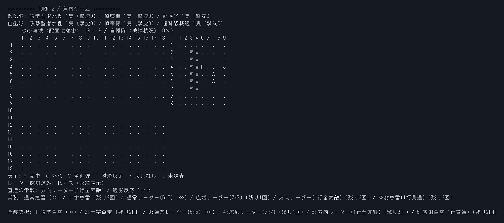

# 魚雷ゲーム

## ゲームの概要

魚雷とレーダーを使って、位置が見えない敵艦隊を探す1人用のターン制海戦ゲームです。8種類の艦種から2〜3隻を選び、ターミナル上でCPUと対戦します。魚雷で攻撃するか、1ターン使って索敵するかを選びながら、敵を戦闘不能に追い込みます。

## 動作環境

- OS：Windows 11（バージョン 10.0.26200）で動作確認済み。
- Python：3.14.5で動作確認済み。配布時の起動手順は3.13向けです。
- 必要なライブラリ：追加ライブラリ不要（Python標準ライブラリのみ）。
- 日本語を表示できるターミナルを使ってください。WindowsではPowerShellやVS Codeの統合ターミナルを使えます。

## インストール方法

1. Pythonが入っていなければ、[Python公式ダウンロードページ](https://www.python.org/downloads/windows/)からインストールします。インストーラーに「Add Python to PATH」が表示される場合は有効にします。
2. [GitHubのリポジトリ](https://github.com/urostua-netizen/torpedo-game)で **Code → Download ZIP** を選び、ダウンロードしたZIPを展開します。
3. 展開先のうち、`torpedo_game.py` が入っているフォルダーをターミナルで開き、`python --version` でPythonが使えることを確認します。

## 起動方法

```powershell
python torpedo_game.py
```

WindowsでPython 3.13を指定する場合は、`py -3.13 torpedo_game.py` でも起動できます。

| 起動コマンド | 用途 |
| --- | --- |
| `python torpedo_game.py --no-animations` | 演出の待ち時間を省いて遊ぶ |
| `python torpedo_game.py --demo --no-animations --seed 7` | 入力なしの自動対戦で起動を確認する |
| `python torpedo_game.py --debug 6 --no-animations` | 敵の配置が見える6×6盤面で攻撃や索敵を試す |

## 操作方法

1. **難易度を選ぶ。** `1` は「かんたん」、`2` または Enter は「ふつう」、`3` は「むずかしい」です。かんたん・ふつうは双方9×9、むずかしいは自軍9×9・敵軍18×18です。
2. **艦隊を編成する。** 艦種の番号を空白で区切って2〜3隻選びます。たとえば `1 5 8` で攻撃型潜水艦・偵察機・超弩級戦艦を編成できます。同じ艦種も選べます。
3. **艦を配置する。** Enter または `a` で自動配置します。`m` で手動配置を選ぶ場合は、左上の座標を入力し、回転するなら `y` を押します。予定マスは `*` で表示され、Enter または `y` で確定、`n` で置き直せます。盤外や重複がある場合は再入力します。
4. **攻撃か索敵を選ぶ。** 兵装メニューの番号を入力してから、目標を **「列 行」** の順で指定します。`3 5` なら左から3列目、上から5行目です。二連装魚雷は目標を2つ入力します。方向レーダーと斉射魚雷では方向も入力します。行・列を端から端まで対象とする兵装では `w/s` が縦1列、`a/d` が横1行です。かんたん・ふつうの方向レーダーでは `w/a/s/d` が上／左／下／右です。
5. **勝敗を確認する。** 攻撃・索敵のどちらも1ターンを使います。操作後に Enter を押すとCPUが反撃します。艦が占めるマスすべてに命中すると撃沈です。相手が攻撃できる艦を失うと勝利、自軍が失うと敗北です。兵装や座標の入力で `q` を入力すると終了できます。

### 盤面の記号

| 記号 | 意味 |
| --- | --- |
| `X` | 命中・撃沈したマス |
| `o` | 外れ |
| `?` | 至近弾。攻撃したマスの周囲8マスに艦がいる |
| `^` / `-` | レーダーで艦影あり／反応なし |
| `.` | 未調査 |

## 追加・改良した機能

### 改良機能01：残り使用回数の表示

兵装メニューと戦闘画面に、残り回数や無制限を示す `∞` を表示します。

### 改良機能02：手動配置プレビュー

配置予定マスと、盤外・重複の有無を確定前に確認できます。

### 改良機能03：難易度選択

かんたんのCPUは未攻撃マスからランダムに攻撃します。ふつうでは命中・至近弾の周囲を優先します。むずかしいでは敵海域が18×18になり、CPUは縦横に並んだ命中マスの延長を優先します。

### 改良機能04：新艦種と専用魚雷

戦艦は横3マスの貫通魚雷、駆逐艦は中央と斜め4マスのX字魚雷、超弩級戦艦は横1行または縦1列を端から端まで攻撃する斉射魚雷を装備します。専用魚雷の使用回数はいずれも2回です。

### 改良機能05：むずかしいでの索敵強化

レーダーの範囲が広がり、探知マークがゲーム終了まで残ります。攻撃済みマスには攻撃結果が優先表示されます。

| レーダー | かんたん・ふつう | むずかしい |
| --- | --- | --- |
| 通常 | 3×3・無制限 | 5×5・無制限 |
| 広域 | 5×5・1回 | 7×7・1回 |
| 方向 | 指定方向へ最大5マス・2回 | 横1行または縦1列の全18マス・3回 |
| 探知マーク | 探索後2行動で消える | ゲーム終了まで表示 |

## スクリーンショット

むずかしいモードのターン2。敵海域を左、自艦隊を右に表示し、敵海域には索敵結果が残っています。画像は実際のゲーム出力から作成しました。



## 既知の問題・制限事項

- CPU戦専用で、CPUが使用する攻撃兵装は通常魚雷のみです。
- 空母と偵察機だけで編成すると攻撃できず、開始時に敗北します。
- むずかしいでは盤面の横幅が広いため、表示が折り返される場合はターミナルを広げてください。
- デバッグでは敵配置が固定で表示され、CPUは反撃しません。狭い盤面に収まらない編成は選び直す必要があります。

## クレジット

- ベースとなったゲーム：授業配布資料「w13_最終制作_8作品改良ベース」に含まれる `torpedo_game.py` です。
- 使用した外部素材・ライブラリ：なし（ゲームの実行時）。掲載画像は実際のゲーム出力から作成しました。
